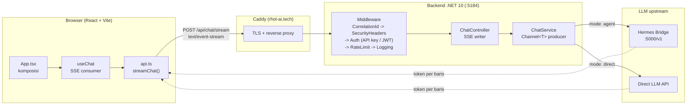

# OmniChat — Hybrid AI Dashboard (.NET 10 + React)

Web UI dengan 2 mode:
- **⚡ Direct Mode** — prompt langsung ke LLM via OpenRouter (streaming SSE, cepat)
- **🤖 Agent Mode** — prompt ke Hermes Agent Gateway (`localhost:5000`, punya tools + memory + skills)

## Fitur

- ✅ SSE streaming (Server-Sent Events) dengan auto-scroll dan stop button
- ✅ Clean Architecture (Domain / Application / Infrastructure / Controllers)
- ✅ Dual-mode toggle: Hermes Bridge vs Direct LLM
- ✅ Markdown rendering dengan GFM support
- ✅ Model selector dropdown
- ✅ Health check endpoint (`/health`)
- ✅ Global exception handling middleware
- ✅ Configurable rate limiting (token-bucket per IP — tune via `RateLimit__TokenLimit` / `RateLimit__ReplenishmentPeriodSeconds`, default 10 req/min)
- ✅ Docker containerization (multi-stage build)
- ✅ Integration tests (WebApplicationFactory)
- ✅ OpenAPI documentation
- ✅ API-key authentication middleware (constant-time compare, exempt `/health`)
- ✅ Correlation ID middleware (`X-Correlation-Id` header + logging scope)
- ✅ Configurable CORS policy per environment
- ✅ CI/CD pipeline (GitHub Actions — backend + frontend)
- ✅ Structured access logging (method, path, status, duration, correlation id)
- ✅ Enriched health check (`/health` → JSON: status, version, uptime)
- ✅ JWT bearer authentication (HMAC-SHA256, validates signature/issuer/audience/lifetime) alongside the API key
- ✅ Dynamic model catalog (`GET /api/models`) — backend-configured, consumed by the UI
- ✅ `.dockerignore` + curl-equipped runtime image (working healthcheck; no secrets/artifacts in the build context)
- ✅ Security response headers middleware (`X-Content-Type-Options`, `X-Frame-Options`, `Referrer-Policy`, `X-Permitted-Cross-Domain-Policies`) + `Server` header suppression
- ✅ Startup configuration validation (warns on empty API key / CORS / JWT signing key in production)
- ✅ Request body size limit (Kestrel `MaxRequestBodySize`, configurable, default 10 MB)
- ✅ Input validation hardening (`ChatRequest`: model max 100 chars, messages max 50 items; `ChatMessage`: role whitelist `[user|assistant|system]`, content max 8000 chars)
- ✅ Graceful shutdown (30s timeout — in-flight SSE streams complete during container stop)
- ✅ Docker Compose memory limits (backend 512 MB, frontend 256 MB)
- ✅ Frontend API key authentication (sidebar input, localStorage persistence, `X-Api-Key` header sent on every API request)
- ✅ JSON structured logging in production (`Console:json` formatter — machine-readable for ELK / Grafana Loki)
- ✅ Integration test coverage for `/api/models` auth (401 without key, 200 with key)
- ✅ Rate-limit `Retry-After` header (429 responses include seconds-to-retry + JSON error body)
- ✅ Response compression (Brotli + Gzip for JSON endpoints; SSE excluded)
- ✅ Model catalog cache headers (`Cache-Control: public, max-age=60` on `/api/models`)
- ✅ Frontend 429 handling (reads `Retry-After` header and shows retry countdown)
- ✅ RFC 7807 ProblemDetails standardization — all error responses (400, 401, 429, 500) use `application/problem+json` with consistent `{ title, status, detail, instance, traceId }` schema
- ✅ SSE error sanitization — mid-stream exceptions send a generic error event instead of leaking `ex.Message` (internal URLs, API keys, stack traces) to the client
- ✅ Frontend SSE error event handling — `parsed.error` events from the backend are displayed to the user instead of being silently swallowed
- ✅ MIT License — project is openly licensed for portfolio use
- ✅ Enriched OpenAPI schema (`/openapi/v1.json` in Development) with document metadata (title, description, contact, MIT license) via `IOpenApiDocumentTransformer`
- ✅ `CHANGELOG.md` — formal changelog documenting all milestones for portfolio readability
- ✅ Non-root container execution (backend: `app` UID 101, frontend: `node` UID 1000) + `no-new-privileges` + `cap_drop: ALL`
- ✅ API reference documentation (endpoints, curl examples, request/response schemas, SSE format, RFC 7807 error table)
- ✅ Frontend component tests (Vitest + @testing-library/react + jsdom — 23 tests covering rendering, mode toggle, model catalog fetch/fallback, API key persistence, input/send interactions)

## Prerequisites

- .NET SDK 10.0+ ([download](https://dotnet.microsoft.com/download))
- Node.js 22+ and npm
- (Optional) Docker 24.0+
- (Optional) OpenRouter API key
- (Optional) Hermes Agent running on `localhost:5000`

## Struktur Project

```
OmniChat/
├── src/OmniChat.Api/          → Backend .NET 10 (Clean Architecture)
│   ├── Controllers/           → ChatController (SSE endpoint)
│   ├── Domain/Models/         → ChatRequest, ChatMessage
│   ├── Application/Interfaces/→ IChatService
│   ├── Infrastructure/        → ChatService, Middleware, Auth (JwtTokenValidator)
│   ├── Program.cs             → App entry point + DI + rate limiting
│   └── appsettings*.json      → Environment-based config
├── frontend/                  → React + TypeScript + Vite + Tailwind v4
├── tests/OmniChat.Tests/      → xUnit + Moq + WebApplicationFactory
│   ├── Controllers/           → Unit tests
│   ├── Services/              → Unit tests (SSE parsing, fallback)
│   └── Integration/           → Integration tests (full HTTP pipeline)
├── docs/                      → Plans + Deployment guide
├── Dockerfile                 → Multi-stage backend build
├── docker-compose.yml         → Backend + Frontend orchestration
└── OmniChat.slnx             → .NET 10 XML solution file
```


## API Reference

### Authentication

Protected endpoints accept **either** scheme (both are inert until configured):

- `X-Api-Key: <key>` — set via `Security:ApiKey` (constant-time compare).
- `Authorization: Bearer <token>` — enabled when `Security:Jwt:SigningKey` is set.
  Validates HMAC-SHA256 signature, issuer, audience, and lifetime.

Rules: exempt paths (`/health`, `/openapi`) always pass; a present-but-invalid
bearer token returns `401` (no fallback); with no bearer token the request
falls back to the API key when one is configured. If `Security:ApiKey` is empty
the API is open (pass-through).

The frontend includes an **API Key** input in the sidebar (stored in
`localStorage`). When set, the key is sent as the `X-Api-Key` header on every
API request (`/api/models` and `/api/chat/stream`).

### Endpoints

| Method | Path | Description | Auth |
|--------|------|-------------|------|
| `POST` | `/api/chat/stream` | Stream chat completion (SSE) | ✅ |
| `GET` | `/api/models` | Get model catalog | ✅ |
| `GET` | `/health` | Health check (status, version, uptime) | ❌ |
| `GET` | `/openapi/v1.json` | OpenAPI document (Development only) | ❌ |

### POST /api/chat/stream

Streams a chat completion as Server-Sent Events.

**Request body:**
```json
{
  "model": "hermes",
  "useHermesBridge": true,
  "messages": [
    { "role": "user", "content": "Hello, how are you?" }
  ]
}
```

**Response:** `text/event-stream`

```
data: {"content":"Hello"}

data: {"content":"! I'm "}

data: {"content":"doing well."}

data: [DONE]
```

**Error event (mid-stream):**
```
data: {"error":"An internal error occurred during streaming."}
```

**Validation rules:**
- `model` — required, max 100 characters
- `messages` — required, 1–50 items
- `messages[].role` — must be `user`, `assistant`, or `system`
- `messages[].content` — required, max 8000 characters

Invalid input returns `400 Bad Request` as an RFC 7807 `ValidationProblemDetails`
response (see [Error Responses](#error-responses-rfc-7807) below).

### GET /api/models

Returns the model catalog grouped by chat mode (`Cache-Control: public, max-age=60`).

Configure via the `Models` config section (see [Environment Variables](#environment-variables)):
a JSON array in `Models__Agent`/`Models__Direct`, indexed keys, or `appsettings.json`.
Unset or malformed values fall back to the built-in list.

**Response:**
```json
{
  "agent": [
    { "id": "hermes", "label": "Hermes (Default)" }
  ],
  "direct": [
    { "id": "meta-llama/llama-3.3-70b-instruct:free", "label": "Llama 3.3 70B (Free)" }
  ]
}
```

### GET /health

Returns enriched health information (exempt from auth).

**Response:**
```json
{
  "status": "Healthy",
  "version": "1.0.0.0",
  "uptimeSeconds": 42,
  "checks": []
}
```

### Error Responses (RFC 7807)

All error responses follow the [RFC 7807 ProblemDetails](https://datatracker.ietf.org/doc/html/rfc7807)
format with `application/problem+json` content type. Every error includes a
`traceId` for correlating with server logs.

**Common structure:**
```json
{
  "title": "Unauthorized",
  "status": 401,
  "detail": "Missing or invalid API key.",
  "instance": "/api/chat/stream",
  "traceId": "00-abc123..."
}
```

| Status | Title | When |
|--------|-------|------|
| 400 | Validation Failed | Invalid request body (missing/empty fields, role not in `user\|assistant\|system`, etc.) — includes an `errors` dictionary |
| 401 | Unauthorized | Missing or invalid `X-Api-Key` / `Authorization: Bearer` token |
| 429 | Too Many Requests | Rate limit exceeded — includes a `Retry-After` header (seconds) |
| 500 | Internal Server Error | Unhandled server exception — `detail` is generic, `traceId` for debugging |

**Validation error example (400):**
```json
{
  "title": "Validation Failed",
  "status": 400,
  "errors": {
    "Messages": ["The Messages field is required."],
    "Model": ["The Model field is required."]
  },
  "traceId": "00-abc123..."
}
```

### OpenAPI Schema (Development only)

In Development mode, the OpenAPI schema is served at `/openapi/v1.json` with
enriched document metadata (title, description, version, contact, MIT license)
via `IOpenApiDocumentTransformer`. The schema includes all endpoint paths, HTTP
methods, response status codes (200, 400, 401, 429), and content types.
This is disabled in Production to avoid exposing API metadata.

### curl Examples

```bash
# Chat stream (SSE) — -N disables buffering for streaming
curl -N -H "X-Api-Key: YOUR_KEY" \
  -H "Content-Type: application/json" \
  -d '{"model":"hermes","useHermesBridge":true,"messages":[{"role":"user","content":"Hello"}]}' \
  http://localhost:5184/api/chat/stream

# Get model catalog
curl -H "X-Api-Key: YOUR_KEY" http://localhost:5184/api/models

# Health check (no auth needed)
curl http://localhost:5184/health
```

## Menjalankan

### Backend (.NET 10)

```bash
cd src/OmniChat.Api
dotnet run --environment Development
```

API key OpenRouter isi di `appsettings.json` → `LLM:ApiKey` (jangan commit key!).
Tanpa key, backend tetap jalan dengan **fallback simulation mode**.

### Frontend

```bash
cd frontend
npm install
npm run dev
```

Buka http://localhost:5173 — request `/api/*` otomatis di-proxy ke backend port 5184.

### Docker

```bash
docker compose up -d --build
# Backend: http://localhost:5184
# Frontend: http://localhost:4173
```

The frontend Docker image uses **nginx** to serve static files and proxy `/api/*`
to the backend (with SSE support — `proxy_buffering off`). No `VITE_API_PROXY_TARGET`
needed in Docker; nginx.conf handles the proxy.

Lihat [docs/deployment.md](docs/deployment.md) untuk panduan lengkap deployment.

## Testing

```bash
# Backend — all tests (unit + integration)
dotnet test OmniChat.slnx -c Release

# Frontend — component tests (Vitest)
cd frontend && npm run test

# Frontend — production build check
cd frontend && npm run build
```


## Environment Variables

| Variable | Config Section | Required | Description |
|---|---|---|---|
| `Hermes__Endpoint` | `Hermes:Endpoint` | No (default: localhost) | Hermes Agent gateway chat-completions URL. In Docker: `http://host.docker.internal:5000/v1/chat/completions` |
| `LLM__Endpoint` | `LLM:Endpoint` | No (default: OpenRouter) | Direct-mode LLM provider chat-completions URL |
| `LLM_API_KEY` | `LLM:ApiKey` | No | OpenRouter API key for Direct mode. Leave empty for Hermes-only use |
| `Security__ApiKey` | `Security:ApiKey` | **Yes (prod)** | API key sent via `X-Api-Key` header. **Empty = open access** |
| `Security__Jwt__SigningKey` | `Security:Jwt:SigningKey` | No | HMAC-SHA256 key for JWT validation. Empty = JWT auth disabled |
| `Security__Jwt__Issuer` | `Security:Jwt:Issuer` | No (default: `OmniChat`) | JWT issuer claim |
| `Security__Jwt__Audience` | `Security:Jwt:Audience` | No (default: `OmniChat`) | JWT audience claim |
| `Kestrel__MaxRequestBodySizeBytes` | `Kestrel:MaxRequestBodySizeBytes` | No (default: 10 MB) | Max request body size in bytes (DoS prevention) |
| `Cors__AllowedOrigins` | `Cors:AllowedOrigins` | No (see note) | Comma-separated allowed origins. In Production an empty list registers a policy that rejects every cross-origin request — the same-origin SPA still works, but no cross-origin client can call the API |
| `ReverseProxy__Enabled` | `ReverseProxy:Enabled` | No (default: `false`) | Process `X-Forwarded-For`/`X-Forwarded-Proto` from trusted proxies (set `true` only behind a reverse proxy) |
| `ReverseProxy__KnownProxies` | `ReverseProxy:KnownProxies` | No (empty) | Comma-separated trusted proxy IPs |
| `ReverseProxy__KnownNetworks` | `ReverseProxy:KnownNetworks` | No (empty) | Comma-separated trusted proxy CIDR networks (e.g. `172.18.0.0/16`) |
| `ReverseProxy__ForwardLimit` | `ReverseProxy:ForwardLimit` | No (default: `1`) | Max forwarded entries to process (only the closest proxy at `1`) |
| `VITE_API_PROXY_TARGET` | — | No (Docker override) | Frontend `/api` proxy target. Docker sets `http://backend:5184` |
| `Models__Agent` | `Models:Agent` | No (built-in defaults) | Hermes/Agent model list as a JSON array of `{"Id","Label"}` objects. Empty = built-in defaults. Indexed keys (`Models__Agent__0__Id=…`) also work and win when both are set |
| `Models__Direct` | `Models:Direct` | No (built-in defaults) | Direct-provider model list as a JSON array of `{"Id","Label"}` objects. Empty = built-in defaults |
| `RateLimit__TokenLimit` | `RateLimit:TokenLimit` | No (default: `10`) | Max requests per period per client IP (token-bucket) |
| `RateLimit__ReplenishmentPeriodSeconds` | `RateLimit:ReplenishmentPeriodSeconds` | No (default: `60`) | Token replenishment period in seconds |
| `Streaming__IdleTimeoutSeconds` | `Streaming:IdleTimeoutSeconds` | No (default: `120`) | Abort the upstream call after this many seconds with no bytes received. Renewed on every line, so a healthy long generation is never cut short. `0`/negative disables |

> **⚠️ Security:** `Security__ApiKey` **must** be set in any non-local deployment — an empty value means the API is open with no authentication. `Cors__AllowedOrigins` is a different case: leaving it empty in Production is **safe** (the policy then rejects every cross-origin request, and the SPA is served same-origin so it is unaffected). Set it only if a legitimate cross-origin client needs access. It is required in Development, where an empty list falls back to `AllowAnyOrigin`.

## Architecture

**Alur request (streaming):**



**Clean Architecture Lite:**
- **Domain** — `ChatRequest`, `ChatMessage` (models + validation)
- **Application** — `IChatService` (interface, no dependencies on infrastructure)
- **Infrastructure** — `ChatService` (Channel<T> producer pattern for SSE streaming, HttpClient for LLM calls)
- **Controllers** — `ChatController` (SSE response writer, rate limiting, OpenAPI metadata)

**Key decisions:**
- `ChatService` uses `Channel<T>` producer pattern (yield cannot be in try/catch in C#)
- `Microsoft.OpenApi` pinned to 2.12.0 (fixes GHSA-v5pm-xwqc-g5wc)
- Solution uses `.slnx` format (.NET 10 XML-based solution)
- Rate limiting: token bucket, 10 req/min per IP (returns 429 on excess)
- Authentication: dual scheme — `ApiKeyMiddleware` + `JwtAuthenticationMiddleware` (JWT validated by `JwtTokenValidator`, claim names kept verbatim via `MapInboundClaims=false`)

## Screenshots

Tangkapan layar berikut menjelaskan UI yang sebenarnya. Gambar **belum** disertakan di repo — daftar ini adalah daftar yang diminta; kirim berkasnya dan akan ditempatkan di `docs/screenshots/` dengan nama yang tertera.

| Berkas yang diharapkan | Viewport | Yang harus terlihat |
|---|---|---|
| `docs/screenshots/desktop-chat.png` | 1280×800 | Percakapan aktif dengan jawaban markdown (blok kode + tombol Copy) dan sidebar terbuka |
| `docs/screenshots/mobile-chat-375.png` | 375×667 (iPhone SE) | Composer + gelembung pesan, tanpa scroll horizontal |
| `docs/screenshots/mobile-drawer-375.png` | 375×667 | Sidebar drawer terbuka (toggle mode, pemilih model, input API key, Clear chat) |
| `docs/screenshots/mode-toggle.png` | 1280×800 | Perbedaan Direct Mode dan Agent Mode (badge mode di top bar) |
| `docs/screenshots/error-state.png` | 375×667 | Pesan error `⚠️ Autentikasi diperlukan (401)` di transcript saat API key kosong |

Cara mengambil ulang: jalankan stack secara lokal, atur viewport seperti kolom di atas, lalu tangkap layar. Untuk mode gelap sudah menjadi default (tema `bg-slate-950`), jadi tidak ada tangkapan layar tema terang.

## Milestones

- **Milestone 1** ✅ — Core SSE streaming, Clean Architecture, Hermes Bridge + Direct LLM
- **Milestone 2** ✅ — Quality, testing, resilience, frontend polish (33 tests, 0 warnings)
- **Milestone 3** ✅ — Docker, env config, rate limiting, integration tests, deployment guide, API-key auth, CORS, correlation ID, CI/CD
- **Milestone 4** ✅ — Security & observability hardening (API-key auth, correlation-id, configurable CORS)
- **Milestone 5** ✅ — Observability & production readiness (request logging, enriched JSON health check, rate-limit integration coverage) — 46 tests, 0 warnings
- **Milestone 6** ✅ — JWT bearer authentication (dual-auth with API key, HMAC-SHA256 validation, unit + integration coverage) — 67 tests, 0 warnings
- **Milestone 7** ✅ — Dynamic model catalog (`GET /api/models`), backend-configured, consumed by the UI — 72 tests, 0 warnings
- **Milestone 8** ✅ — Deployment config correctness (env-var ↔ config-section names verified, `Security__Jwt__SigningKey` fix, `LLM__Endpoint` forwarded, deployment-config regression guard) — 76 tests, 0 warnings
- **Milestone 9** ✅ — Container & deployment hardening: runtime image now installs `curl` so the docker-compose healthcheck actually passes (previously `curl` was missing → backend permanently `unhealthy` → frontend never started); added root `.dockerignore` (excludes `.env`/`node_modules`/`bin`/`obj` from the build context); reproducible frontend runtime image (`npm ci` from the lockfile); `Dockerfile` `HEALTHCHECK` for plain `docker run` — 80 tests, 0 warnings
- **Milestone 10** ✅ — Security headers & production hardening: `SecurityHeadersMiddleware` adds `X-Content-Type-Options: nosniff`, `X-Frame-Options: DENY`, `Referrer-Policy: strict-origin-when-cross-origin`, `X-Permitted-Cross-Domain-Policies: none` to every response; Kestrel `Server` header suppressed (`AddServerHeader = false`); README env-var reference table added — 90 tests, 0 warnings
- **Milestone 11** ✅ — Production startup validation & request safety: `StartupConfigValidator` logs warnings for empty `Security:ApiKey`, `Cors:AllowedOrigins`, and `Security:Jwt:SigningKey` in Production; Kestrel `MaxRequestBodySize` configurable (default 10 MB, DoS prevention); JWT issuer/audience env vars documented and forwarded by docker-compose; README typo fixed — 105 tests, 0 warnings
- **Milestone 12** ✅ — Input validation & production hardening: `ChatRequest`/`ChatMessage` input validation (model max 100 chars, messages max 50 items, role whitelist `user|assistant|system`, content max 8000 chars); graceful shutdown timeout (30s for in-flight SSE streams); Docker Compose memory limits (backend 512 MB, frontend 256 MB); 21 new tests (validation unit + integration + deployment config guards) — 126 tests, 0 warnings
- **Milestone 13** ✅ — Frontend API key authentication (sidebar input with localStorage persistence, `X-Api-Key` header on every API request, auto-refresh model catalog on key change); JSON structured logging in production (`Console:json` formatter for ELK/Loki); integration tests for `/api/models` auth (401 without key, 200 with key) — 128 tests, 0 warnings
- **Milestone 14** ✅ — API response quality polish: rate-limit `Retry-After` header + JSON error body on 429; response compression (Brotli + Gzip for `/health` and `/api/models`, SSE excluded); `Cache-Control: public, max-age=60` on `/api/models`; frontend reads `Retry-After` and shows retry countdown; README duplicate fix + OpenAPI docs note — 137 tests, 0 warnings
- **Milestone 15** ✅ — RFC 7807 ProblemDetails standardization: all error responses (400 validation, 401 auth, 429 rate limit, 500 server error) now use `application/problem+json` with consistent `{ title, status, detail, instance, traceId }` schema; `AddProblemDetails()` + custom `ApiBehaviorOptions.InvalidModelStateResponseFactory` registered; `ProblemDetailsJson` helper (camelCase serialization); 13 new tests (6 ProblemDetails integration + 7 deployment config guards) — 150 tests, 0 warnings
- **Milestone 16** ✅ — Reverse-proxy forwarded headers: `ForwardedHeadersSetup` + `ReverseProxyOptions` (`ReverseProxy:*` section) wire `UseForwardedHeaders` (`X-Forwarded-For`/`X-Forwarded-Proto`) so the per-IP rate limiter and request logs see the real client behind nginx/Caddy instead of the proxy address; opt-in (`Enabled=false` default), trust is additive (loopback defaults preserved, spoofed headers from unlisted peers ignored), CIDR parsing via `System.Net.IPNetwork`; `StartupConfigValidator` warns when enabled with no trusted proxies; docker-compose/`.env.example`/`README`/`deployment.md` updated — 184 tests, 0 warnings
- **Milestone 17** ✅ — Model-catalog configurability & deployment-config completeness: `ModelCatalogService` exposes public section constants and accepts a single JSON-array env var (`Models__Agent`/`Models__Direct`) in addition to indexed keys, with malformed JSON logged and falling back to defaults; docker-compose forwards the catalog vars; `.env.example`, README and `deployment.md` document them; the `frontend` docker-compose service gains a `node`-based readiness healthcheck (no curl/wget dependency); deployment-config regression guards extended — 189 tests, 0 warnings
- **Milestone 18** ✅ — SSE error sanitization & project metadata: `ChatController.StreamChat` catch block now sends a generic `"An internal error occurred during streaming."` error event via `JsonSerializer.Serialize` instead of `ex.Message` (which could leak internal URLs, API keys, and stack traces to the client since the SSE response has already started and `ExceptionHandlingMiddleware` cannot intervene); `ChatService.ProduceTokensAsync` upstream-error message sanitized to not reveal the provider's HTTP status code; frontend `App.tsx` now handles `parsed.error` in SSE events and displays them to the user instead of silently ignoring them; MIT `LICENSE` file added; CI workflow updated with NuGet cache + frontend `npm run lint` step. 11 new tests (2 ChatController sanitization + 2 ChatService leak prevention + 3 deployment config guards + 4 updated existing tests). 200 tests, 0 warnings, frontend builds, CI green.
- **Milestone 19** ✅ — OpenAPI document enrichment & CHANGELOG: `/openapi/v1.json` now carries document-level metadata (title "OmniChat API", description, version, contact, MIT license) via `IOpenApiDocumentTransformer` instead of bare defaults; `StreamChat` action declares `401 Unauthorized` in its OpenAPI response types (auth middleware can reject before the action runs); `CHANGELOG.md` added documenting all milestones (M1–M19) in Keep a Changelog format. 7 integration tests (OpenAPI metadata: title, version, description, contact, license, paths, status codes) + 4 deployment config guards. 211 tests, 0 warnings, frontend builds, CI green.
- **Milestone 20** ✅ — Non-root container hardening + API reference docs: backend Dockerfile runs as `app` (UID 101); frontend runs as `node` (UID 1000); both use `--chown` on COPY, `no-new-privileges:true`, and `cap_drop: ALL` in docker-compose; README gains a structured API Reference section (endpoint table, curl examples, request/response schemas, SSE event format, RFC 7807 error table, validation constraints) — 219 tests, 0 warnings
- **Milestone 22** ✅ — Frontend component testing: Vitest + @testing-library/react + jsdom setup; 23 tests covering rendering, mode toggle, model catalog fetch with fallback, API key localStorage persistence, send/stop button interactions, and clear chat; CI runs `npm run test`; `tsconfig.app.json` excludes test files from production build typecheck — 223 backend tests + 23 frontend tests, 0 warnings, CI green.
- **Milestone 24** ✅ — nginx frontend proxy fix + non-root hardening: fixed critical deployment blocker where `nginx.conf` had no `/api` proxy (API calls from Docker frontend got 404); added `/api/` location block with SSE support (`proxy_buffering off`, `proxy_read_timeout 86400s`); frontend Dockerfile now runs nginx as non-root (`USER nginx`, pre-created/chowned cache dirs, PID path → `/tmp`); re-enabled `cap_drop: ALL` + `no-new-privileges` on frontend service; removed stale `VITE_API_PROXY_TARGET` from docker-compose (nginx handles proxy); updated deployment docs, `.env.example`, and README to reflect nginx (not vite preview); 7 new deployment config tests (nginx proxy, SSE support, SPA fallback, non-root cache dirs, PID path, VITE var removal) — 243 backend tests, 0 warnings, CI green.
